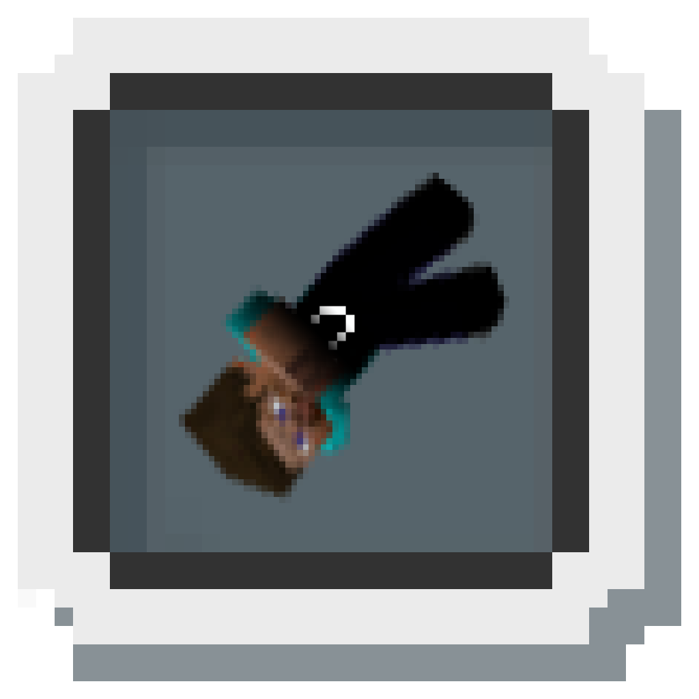

<h1 style="padding-top: 0;">NotSoSecret</h1>

A small mod that removes the "Secret Mode" auto-join test code, as well as restoring access to the Inventory in b1.2_02-20110517

#### Installation
- Download the mod from the releases
    - Theoretically, the mod SHOULD work between Fabric-based loaders, as there is no dependency on the OSL itself, and b1.2_02-20110517 is already deobfuscated.
    - This has not been tested though. Should it not work on your loader, please continue with the installation steps yourself.
- **Instructions still need to be written for this as Ornithe does not currently support `b1.2_02-20110517` outside of an experimental devenv made by somebody else.**

### *What's different?*
b1.2_02-20110517 by default generates and joins a new world ('SecretLevel') when the Title Screen is initialized.
This makes it impossible to save and play your own worlds.

Additionally, the key listener for opening the Inventory have been commented out, making the Inventory inaccessible via normal means.

This mod disables the world autojoining, whilst still allowing the Secret Level to be played on the Select World screen.
In addition to the above changes, the Inventory bindings are properly reintroduced.

<figure>
  
  <figcaption>A warning screen that appears when the user attempts to load a world which uses ZonifiedBeta, without ZonifiedBeta installed. Click the image to watch a showcase video of LoadZone, ZonifiedBeta, and NotSoSecret on YouTube</figcaption>
</figure>